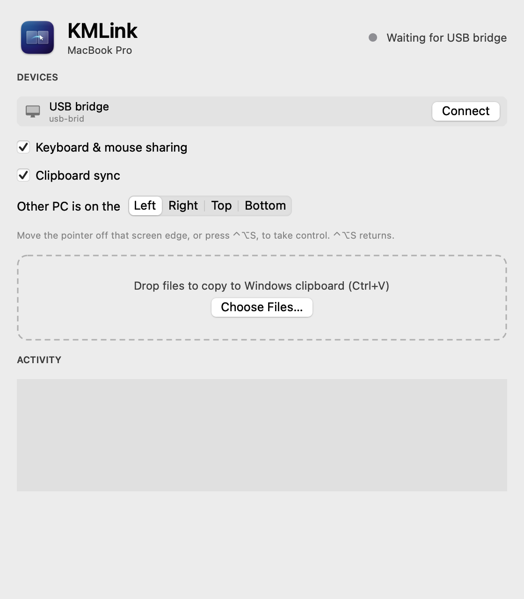
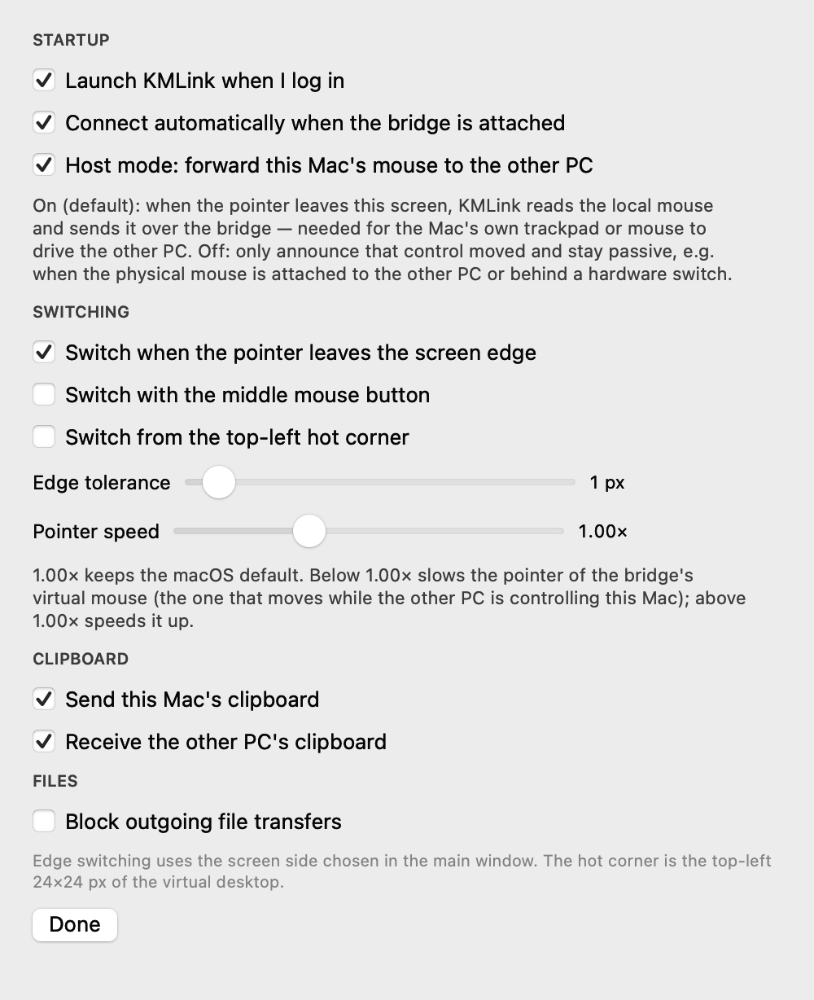

# KMLink

English | [简体中文](README.zh-CN.md)

Native Apple Silicon (`arm64`) open-source macOS client for OTi USB KVM / Data Bridge cables (`VID 0x0EA0` / `PID 0x2213`), compatible with the official Windows **GO! Bridge** software — **no Rosetta and no DriverKit entitlement required**.



## Overview

Many USB-to-USB Mac↔Windows bridge cables (based on OTi `0x0EA0:0x2213` / `Android+Mac`) ship only an unsigned x86_64 macOS app (`MacKMLink`) that depends on Rosetta 2. **KMLink** is an independent, clean-room native `arm64` Swift/C implementation that drives the bridge directly in user space via Apple's built-in `SCSITaskLib.plugin`.

## Features

- **Native Apple Silicon (`arm64`)**: Compiles directly with macOS Command Line Tools (no Xcode project or Rosetta 2 needed).
- **Bidirectional Keyboard & Mouse Sharing**:
  - Switch across screens via screen edge, top-left hot corner, middle mouse button, or `⌃⌥S`.
  - Supports **Host mode** (forwards Mac trackpad/keyboard over bridge HID) and passive mode.
  - Preserves cursor vertical alignment across different screen resolutions, tunes bridge virtual mouse speed (`Pointer speed`), and automatically restores `com.apple.mouse.scaling` on exit or crash recovery.
- **Bidirectional Clipboard Sync**: Automatically syncs clipboard text between macOS and Windows (`NSPasteboard` isolated on a dedicated serial queue, with macOS 15.4+ pasteboard access checks).
- **USB File Transfer**:
  - **Mac → Windows**: Drop files into the window, pick via **Choose Files…** (`⌘F` from menu bar), or copy/drag files (`0x10` → `0xA3` / `0x37` / `0xA7`), supporting large and non-ASCII filenames.
  - **Windows → Mac**: Copy files on Windows to receive them into `~/Downloads/KMLink/` and automatically place them onto the macOS pasteboard (`⌘V` in Finder). Supports multi-block `0x3A` and standalone little-endian `0xA3` large files.
- **Menu Bar & Hot-Plug**: Lives in the menu bar (`LSUIElement`), polls for bridge re-attachment every 2 s, and supports Launch at Login (`SMAppService` / `LaunchAgent` fallback).



## Requirements

- **macOS 13.0+** on Apple Silicon (`arm64`).
- **Command Line Tools** (`xcode-select --install`, Swift 5+ / Clang). Full Xcode GUI is not required.
- Compatible OTi USB bridge cable (`VID 0x0EA0`, `PID 0x2213`) connected to a Windows PC running the official **GO! Bridge** client.

## Build & Run

```bash
git clone https://github.com/FrankCheungDev/km-link.git
cd km-link
./build.sh
open build/KMLink.app
```

For Developer ID signing and local `/Applications/KMLink.app` installation (preserves Accessibility permissions across rebuilds), see [docs/BUILD-AND-INSTALL.md](docs/BUILD-AND-INSTALL.md) and `./install-local.sh`.

### First-Run Setup

1. **Grant Accessibility permission**: System Settings › Privacy & Security › **Accessibility** → enable **KMLink** (required for `CGEventTap`).
2. **Stop the vendor app if installed**: `SCSITaskDeviceInterface::ObtainExclusiveAccess` requires exclusive access to the bridge's `IOCompactDiscServices` (LUN 1). Quit `MacKMLink` / `GoBridgeDemon` and unmount `/Volumes/MacKMLINK` before launching KMLink, or run [`tools/uninstall-original.sh`](tools/uninstall-original.sh) (see [docs/UNINSTALL-ORIGINAL.md](docs/UNINSTALL-ORIGINAL.md)).
3. **Ad-hoc signature note**: Default builds from `./build.sh` use an ad-hoc signature (`-`). If downloaded or moved across machines, strip quarantine (`xattr -cr build/KMLink.app`) or right-click → Open on first launch.

## Verification

Run the automated verification suite (arm64 build, code signature verification, 15 built-in protocol/engine self-test suites, headless UI rendering, and script syntax checks):

```bash
./verify.sh
```

Diagnostic CLI flags on the app binary:

- `--selftest`: Run all offline protocol, framing, file shuttle, clipboard, and KM geometry self-tests.
- `--kmcheck`: Check Accessibility permission and `CGEventTap` creation.
- `--usbprobe` / `--hidtest` / `--switchtest`: Hardware probes (stop any running KMLink instance first so USB exclusive access is available).

## Known Limitations

- **Windows → Mac non-ASCII filenames**: Requesting files with non-ASCII names copied on Windows currently fails on the Windows `GO! Bridge` peer (`ErrStr "No such file or directory"`). ASCII filenames work normally; Mac → Windows works with Unicode/Chinese filenames.
- **Mac → Windows Finder drag handoff**: Cross-screen Finder drag (`Cmd_Get_Remote_Dragging_Info` + local drag completion) is implemented and covered by `--selftest`, but needs broader real-world desktop verification (the Drop Zone / **Choose Files…** / copy-paste workflow is verified on hardware).
- **Clipboard scope**: USB mode syncs plain text and files; rich clipboard formats (RTF/HTML/images) are not transmitted over the OTi USB channel.
- **Single peer**: Supports a single attached OTi USB bridge cable at a time.

## Repository Layout

```text
Sources/
  main.swift                  CLI probes, headless UI renderers, --selftest suite, app entry
  UI.swift                    Main window, menu bar item, DropView, AppModel orchestration
  Settings.swift              Settings window controller
  LinkNode.swift              USB subsystem facade connecting UI/Clipboard/KMEngine to USBLink
  USBLink.swift               OTi session state machine, handshake, KM/clipboard/file dispatch
  OTIFrame.swift              64 KB OTi frame codec, multi-block split, OTISession / OTIXML
  OTIBridge.swift             uPipe XML command constants and parsers
  OTIFileTransfer.swift       NodeInfo (824B), 0x10/0xA3/0x3A/0x37/0xA7/0xA9 codecs
  SCSITaskTransport.swift     Native user-space OTi transport & OTIBlockAssembler
  SCSITaskShim.c / .h         C bridge to Apple's SCSITaskLib.plugin & HID acceleration tuning
  KMEngine.swift              Dedicated-thread CGEventTap capture, edge/hotkey/hot-corner switch
  Clipboard.swift             Dedicated-queue NSPasteboard watcher & fileURL priority
  Model.swift                 Settings persistence and internal KM/clipboard models
  MouseScaling.swift          Safe com.apple.mouse.scaling toggle & crash recovery
  LaunchAtLogin.swift         SMAppService.mainApp with LaunchAgent fallback
  Notifications.swift         Best-effort local notifications
  BrandIcon.swift             App icon loader and vector fallback
Resources/                    Info.plist, AppIcon.icns/.png, KMLinkLogo.svg
docs/                         Build/install guide, vendor uninstaller guide, Windows USBPcap guide
docs/reverse-engineering/     Protocol notes, SCSI transport findings, KM & file-transfer RE logs
tools/                        Uninstaller, capture scripts, HID & SCSITask utilities (see tools/README.md)
tools/probes/                 Archived exploratory IOKit/USB probes
AGENTS.md                     AI coding agent guidance & architectural invariants
build.sh                      Command Line Tools arm64 build script
install-local.sh              Local Developer ID build & /Applications installer
verify.sh                     Automated build, signature, and self-test verification script
```

## Legal & Disclaimer

This repository contains an independent, clean-room reimplementation of the client software based on behavioral and protocol interoperability analysis. It includes **no** proprietary vendor binaries, libraries, or copyrighted assets. You are responsible for ensuring your use complies with applicable laws and that you use legally owned bridge hardware and official Windows software.

Released under the [MIT License](LICENSE).
