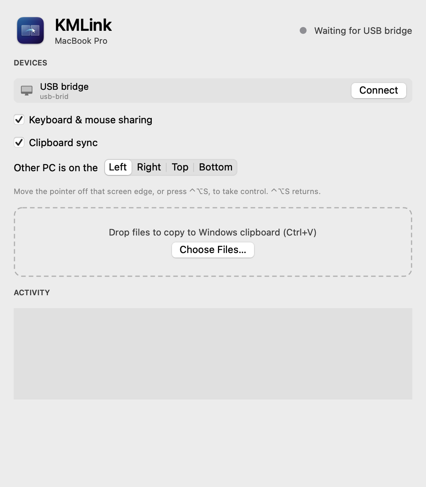
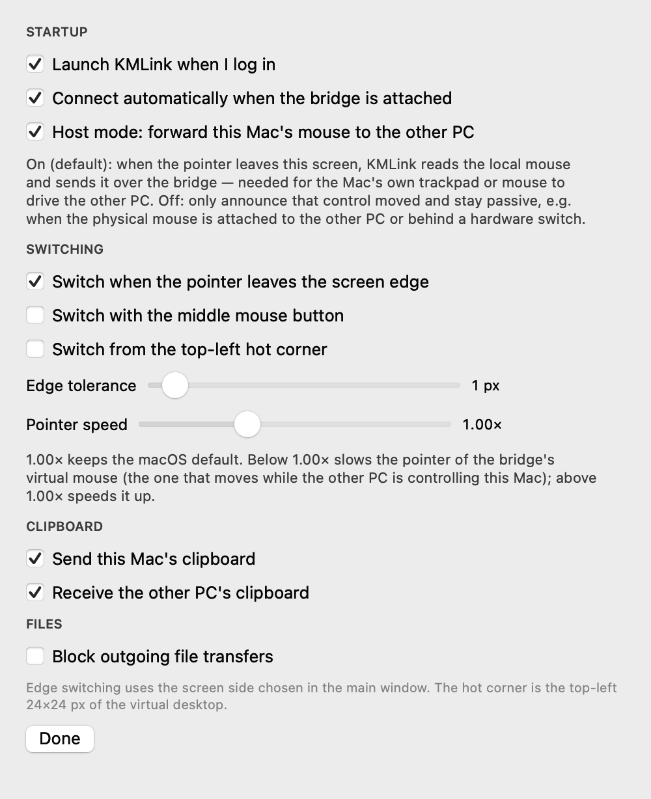

# KMLink

[English](README.md) | 简体中文

面向 Apple Silicon（`arm64`）的 OTi USB KVM / 数据桥接线（`VID 0x0EA0` / `PID 0x2213`）开源原生 macOS 客户端，可直接与官方 Windows 端 **GO! Bridge** 互通——**无需 Rosetta，无需 Apple DriverKit entitlement**。



## 项目简介

市面上许多基于 OTi 方案（`0x0EA0:0x2213` / `Android+Mac`）的 Mac↔Windows USB 桥接对拷线，原厂仅提供未签名的 x86_64 Mac 应用（`MacKMLink`），在 Apple Silicon 上只能通过 Rosetta 2 转译运行。

**KMLink** 是基于行为与协议互操作分析的独立干净实现：直接通过 Apple 系统内置的 `SCSITaskLib.plugin` 在用户态收发厂商 SCSI 命令，全部源码由原生 Swift 与 C 编写，无任何原厂二进制或专有依赖。

## 核心功能

- **纯原生 Apple Silicon（`arm64`）**：仅用 macOS Command Line Tools 即可直接编译，不依赖 Xcode GUI 工程与 Rosetta 2。
- **双向键鼠共享（KM）**：
  - 支持屏幕边缘越界、左上热角、鼠标中键或快捷键 `⌃⌥S` 跨屏切换与返回。
  - 支持 **Host mode**（由 Mac 触控板 / 键盘经桥接 HID 驱动 Windows）及被动模式。
  - 跨屏光标高度按对端屏幕分辨率等比对齐；支持调整虚拟鼠标速度（`Pointer speed`）；控制期间自动关闭 `com.apple.mouse.scaling`，并在退出或异常重启后自动恢复。
- **双向剪贴板同步**：基于独立串行队列的 `NSPasteboard` 监听与写回，防止回环，适配 macOS 15.4+ 剪贴板访问权限策略。
- **USB 双向文件互传**：
  - **Mac → Windows**：拖入主窗口、点击 **Choose Files…**（或菜单栏 `⌘F`），或复制 / 拖拽文件（`0x10` → `0xA3` / `0x37` / `0xA7`），支持大文件与中文文件名。
  - **Windows → Mac**：在 Windows 侧复制文件后自动下载至 `~/Downloads/KMLink/` 并写入 Mac 剪贴板（在 Finder 中 `⌘V` 即可粘贴出真文件），兼容多块 `0x3A` 与大文件独立小端 `0xA3` 传输格式。
- **菜单栏常驻与热插拔**：默认以菜单栏图标常驻（`LSUIElement`），支持 2 秒静默热插拔自动重连与开机自启（优先 `SMAppService`，不可用时回退 `LaunchAgent`）。



## 环境要求

- **Apple Silicon Mac（`arm64`）**，macOS 13.0 及以上
- **Command Line Tools**（`xcode-select --install`，含 `clang` 与 Swift 5+；无需安装完整 Xcode）
- 兼容的 OTi USB 桥接线（`VID 0x0EA0` / `PID 0x2213`），且 Windows 对端运行官方 **GO! Bridge** 客户端

## 构建与运行

```bash
git clone https://github.com/FrankCheungDev/km-link.git
cd km-link
./build.sh
open build/KMLink.app
```

如需使用个人 Apple `Developer ID Application` 证书签名并安装到 `/Applications/KMLink.app`（覆盖升级不丢失辅助功能授权），可运行 `./install-local.sh` 或查阅 [docs/BUILD-AND-INSTALL.md](docs/BUILD-AND-INSTALL.md)。

### 首次运行配置

1. **授予辅助功能权限**：前往「系统设置 › 隐私与安全性 › 辅助功能」勾选 **KMLink**（用于 `CGEventTap` 键鼠捕获）。
2. **让原厂软件让出设备**：`SCSITaskDeviceInterface::ObtainExclusiveAccess` 需要独占桥接线的 `IOCompactDiscServices`（LUN 1）。启动自编版前请先退出原版 `MacKMLink` / `GoBridgeDemon` 并卸载虚拟光盘卷 `/Volumes/MacKMLINK`；如需彻底卸载原版，可使用 [`tools/uninstall-original.sh`](tools/uninstall-original.sh)（使用说明见 [docs/UNINSTALL-ORIGINAL.md](docs/UNINSTALL-ORIGINAL.md)）。
3. **关于默认 ad-hoc 签名**：`./build.sh` 默认使用 ad-hoc 签名（`-`），跨机拷贝或下载后如遇 Gatekeeper 提示，可执行 `xattr -cr build/KMLink.app` 或右键 → 打开。

## 验证与自测

运行自动化验证脚本（覆盖 `arm64` 构建、严格验签、15 组内置协议 / 引擎自测、无界面 UI 渲染与脚本语法检查）：

```bash
./verify.sh
```

常用调试参数：

- `--selftest`：运行全部无硬件依赖的协议编解码、分块重组、文件穿梭、剪贴板与 KM 几何自测。
- `--kmcheck`：检查辅助功能授权与 `CGEventTap` 创建状态。
- `--usbprobe` / `--hidtest` / `--switchtest`：真机硬件探针（运行前需先退出正在驻留的 `KMLink` 以释放 USB 独占访问）。

## 已知限制

- **Windows → Mac 非 ASCII 文件名**：通过剪贴板向 Windows 端请求非 ASCII 文件名时，Windows `GO! Bridge` 对端目前会返回 `ErrStr "No such file or directory"`；ASCII 文件名可正常接收，**Mac → Windows** 方向中文与大文件均已实测通过。
- **Mac → Windows Finder 跨屏直接拖拽**：`Cmd_Get_Remote_Dragging_Info` 交接与本地拖拽清理已实现并通过 `--selftest`，仍待更多真实桌面拖拽场景验证（主窗口投放区 / **Choose Files…** / 复制粘贴链路已实测可用）。
- **剪贴板格式范围**：当前 USB 模式同步纯文本与文件；RTF / HTML / 图片剪贴板未通过 OTi USB 通道传输。
- **单线缆连接**：同一时间仅支持连接一条 OTi USB 桥接线。

## 目录结构与文档索引

```text
Sources/
  main.swift                  CLI 探针、无界面渲染、--selftest 自测套件与程序入口
  UI.swift                    主窗口、菜单栏图标、拖拽区与 AppModel 编排
  Settings.swift              设置窗口控制器
  LinkNode.swift              USB 子系统门面（衔接 UI / 剪贴板 / KMEngine 与 USBLink）
  USBLink.swift               OTi 会话状态机、握手、KM / 剪贴板 / 文件调度
  OTIFrame.swift              64 KB OTi 帧编解码、多块分片与 OTISession / OTIXML
  OTIBridge.swift             uPipe XML 命令常量与解析器
  OTIFileTransfer.swift       NodeInfo（824B）及 0x10 / 0xA3 / 0x3A / 0x37 / 0xA7 / 0xA9 编解码
  SCSITaskTransport.swift     原生用户态 OTi 传输层与 OTIBlockAssembler
  SCSITaskShim.c / .h         对系统 SCSITaskLib.plugin 的 C 桥接与 HID 加速调节
  KMEngine.swift              独立线程 CGEventTap 捕获、边缘 / 热角 / 快捷键切换
  Clipboard.swift             独立队列 NSPasteboard 监听与 fileURL 优先提取
  Model.swift                 偏好设置持久化与内部 KM / 剪贴板数据模型
  MouseScaling.swift          com.apple.mouse.scaling 安全切换与崩溃自愈
  LaunchAtLogin.swift         SMAppService.mainApp 与 LaunchAgent 回退机制
  Notifications.swift         本地通知封装
  BrandIcon.swift             应用图标加载与矢量兜底绘制
Resources/                    Info.plist、AppIcon.icns/.png、KMLinkLogo.svg
docs/                         文档目录
docs/reverse-engineering/     协议分析、SCSI 通道与 KM / 文件传输逆向笔记
tools/                        原版卸载脚本、抓包脚本、HID 与 SCSITask 工具（见 tools/README.md）
tools/probes/                 早期 IOKit / USB 探索性探针归档
AGENTS.md                     AI 编程助手协作指南与核心架构不变量
build.sh                      Command Line Tools arm64 构建脚本
install-local.sh              本机 Developer ID 签名与 /Applications 安装脚本
verify.sh                     自动化构建、验签与自测脚本
```

相关文档：

- 构建、签名与本机安装：[docs/BUILD-AND-INSTALL.md](docs/BUILD-AND-INSTALL.md)
- 原版 `MacKMLink` 一键卸载说明：[docs/UNINSTALL-ORIGINAL.md](docs/UNINSTALL-ORIGINAL.md)
- Windows 侧 USBPcap 抓包指南：[docs/WINDOWS-CAPTURE.md](docs/WINDOWS-CAPTURE.md)
- 逆向与架构记录：[IMPLEMENTATION-NOTES.md](docs/reverse-engineering/IMPLEMENTATION-NOTES.md)、[NATIVE-SCSI-TRANSPORT.md](docs/reverse-engineering/NATIVE-SCSI-TRANSPORT.md)、[PROTOCOL.md](docs/reverse-engineering/PROTOCOL.md)、[KM-MOUSE-RE.md](docs/reverse-engineering/KM-MOUSE-RE.md)、[FILE-TRANSFER-RE.md](docs/reverse-engineering/FILE-TRANSFER-RE.md)
- 辅助工具说明：[tools/README.md](tools/README.md)

## 合规声明与开源协议

本仓库为基于硬件通信行为与协议互操作研究的**独立开源实现**，不包含任何原厂二进制文件、闭源库或受版权保护的专有资产；请在合法持有对应硬件与官方软件的前提下使用。

本项目基于 [MIT License](LICENSE) 开源。
